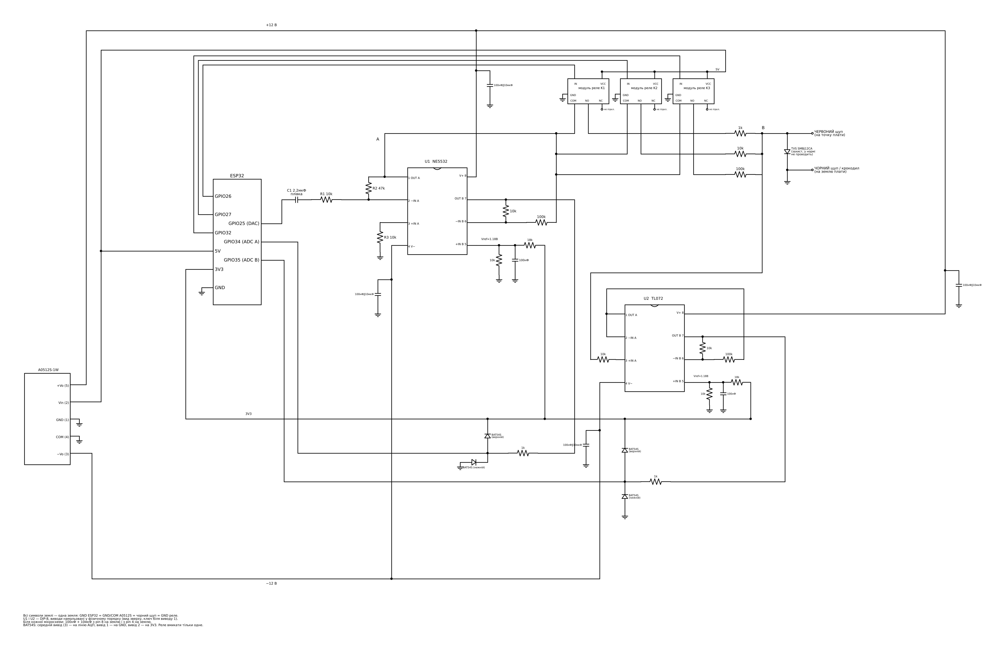

[Українська](README.md) | **English**

# V-I Tester

An open-source DIY V-I tester (analog signature analyzer, Huntron Tracker style) built on an ESP32, for diagnosing boards with no power applied.

The tester drives a sine wave into a point on the board through a series resistor and records current versus voltage. A resistor, a diode, a capacitor, a short and an open circuit each produce a distinct curve. Capture a reference from a known-good board, probe the same points on the faulty one, and the software shows where the curves differ.

> **Status:** prototype. Building the first version of the analog front end.

## How it works

1. The ESP32 generates a sine wave on its DAC (GPIO25, built-in cosine generator, from ~130 Hz).
2. Amplifier U1A (NE5532) removes the DC offset (C1) and amplifies the signal to ±9…10 V (node **A**).
3. One of three relays connects a series resistor Rs: 1k, 10k or 100k (range selection).
4. After Rs (node **B**) comes the red probe. The black probe is the tester's ground and clips onto the board's ground.
5. Two voltages are measured:
   - **A** (what was applied) via scaler U1B → GPIO34;
   - **B** (what remains at the test point) via buffer U2A and scaler U2B → GPIO35.
6. Current through the test point: `I = (VA − VB) / Rs`. Curve: X = VB, Y = I.

The scalers map ±10.5 V into 0.25…2.35 V for the ADC: `Vadc = 1.30 − 0.1·V` (the signal is inverted, which the firmware accounts for).

## Schematic

Vector version: [`schematic.svg`](schematic.svg)

Reading the schematic: a dot means a connection; lines that cross without a dot are not connected. All ground symbols are the same ground: ESP32 GND = A0512S GND/COM = relay GND = black probe.

### ESP32 connections

| ESP32 pin | Goes to |
|---|---|
| GPIO25 (DAC1) | sine output → C1 |
| GPIO34 (ADC1) | node A measurement (via 1k + BAT54S) |
| GPIO35 (ADC1) | node B measurement (via 1k + BAT54S) |
| GPIO26 | relay K1 IN (Rs = 1k) |
| GPIO27 | relay K2 IN (Rs = 10k) |
| GPIO32 | relay K3 IN (Rs = 100k) |
| 5V | relay VCC, A0512S Vin |
| 3V3 | Vref dividers, BAT54S (pin 2) |
| GND | common ground |

### Relay module

| Pin | Goes to |
|---|---|
| VCC | 5V |
| GND | GND |
| IN | its GPIO |
| COM | node A |
| NO | its Rs resistor → node B |
| NC | not connected |

Only one relay is on at a time.

## Bill of materials

Items in parentheses are the fallback to use if something doesn't work as expected (see [Known issues](#known-issues)).

### Active parts and modules

| Ref | Part | Qty | Notes |
|---|---|---|---|
| — | ESP32 DevKit (classic ESP32 with DAC) | 1 | ESP32-C6/S3 won't work, they have no DAC |
| U1 | NE5532P, DIP-8 | 1 | driver (A) + scaler A (B) |
| U2 | TL072CP, DIP-8 | 1 | buffer (A) + scaler B (B) |
| PS1 | A0512S-1W DC-DC, 5 → ±12 V, isolated | 1 | |
| K1–K3 | 5 V relay module, 1 channel | 3 | (if it won't release from 3.3 V: add a transistor between GPIO and IN, or set the module's H/L jumper to high-level trigger) |

### Resistors (metal film, 0.25 W)

| Ref | Value | Qty | Notes |
|---|---|---|---|
| R1 | 10k | 1 | driver input |
| R2 | 62k | 1 | driver gain (**→ 51k** if the sine clips at the peaks) |
| R3 | 10k | 1 | driver (+) to ground |
| Rs1 / Rs2 / Rs3 | 1k / 10k / 100k | 1 / 1 / 1 | ranges; measure with a multimeter and enter the actual values in the firmware |
| — | 100k | 2 | scaler A and B inputs |
| — | 10k | 2 | scaler feedback |
| — | 10k | 1 | series resistor into buffer U2A |
| — | 18k | 2 | Vref divider top |
| — | 10k | 2 | Vref divider bottom |
| — | 1k | 2 | series into ADC inputs |

**Total:** 1k ×3, 10k ×8, 18k ×2, 62k ×1, 100k ×3.

### Capacitors

| Ref | Value | Qty | Notes |
|---|---|---|---|
| C1 | 2.2 µF film, 63–100 V | 1 | must be non-polarized |
| — | 100 nF ceramic | 2 | Vref filter |
| — | 100 nF ceramic | 4 | op-amp decoupling: one on +12 and one on −12 at each IC |
| — | 10 µF electrolytic, 25 V+ | 4 | op-amp decoupling, in parallel with the 100 nF |
| — | 10 µF electrolytic, 25 V+ | 3 | at the A0512S: 5 V input, +12 output, −12 output |
| — | 100–220 µF electrolytic, 10 V+ | 1 | on the 5V line near the relays and A0512S |

### Protection

| Ref | Part | Qty | Notes |
|---|---|---|---|
| D1, D2 | BAT54S | 2 | ADC clamps: pin 3 to the signal line, 1 to GND, 2 to 3V3 |
| TVS1 | SMBJ12CA / 1.5SMBJ12CA | 1 | between node B and GND (**→ 2× 1N4148** from B to the ±12 V rails, moving the TVS between the ±12 V rails and GND, if open probes show an ellipse on the 100k range) |

### Mechanical

| Item | Qty |
|---|---|
| DIP-8 socket | 2 |
| Perfboard | 1 |
| 4 mm banana sockets | 2 |
| Red probe (needle tip for SMD) | 1 |
| Black probe / ground clip | 1 |
| USB cable | 1 |

## Specs

| Range | Rs | Probe short-circuit current (±8.4 / ±10.2 V) | Use for |
|---|---|---|---|
| Low | 1k | 8.4 / 10.2 mA | shorts, low-impedance nets |
| Mid | 10k | 0.84 / 1.02 mA | most test points |
| High | 100k | 84 / 102 µA | IC inputs, leakage |

- Open-probe amplitude: ~±9…10 V. Can be divided by 2, 4 or 8 in software (±4.6 / ±2.3 / ±1.2 V).
- For boards with 1.8 / 1.2 V rails (Apple etc.), ±2.3 or ±1.2 V is the better choice.
- The tester physically can't source more than ~10 mA (limited by Rs).

## Power

Everything runs off a single USB cable, which also carries the data. The 5V pin on an ESP32 DevKit is essentially USB VBUS.

Rough current draw: ESP32 50–80 mA (up to ~250 mA with WiFi), A0512S ~120 mA, one relay ~75 mA. Total 250–300 mA, within the USB 2.0 limit (500 mA). Keep WiFi off while measuring.

Check the voltage on the 5V pin under load: some boards have a diode there and you get 4.3–4.7 V. The A0512S needs at least 4.5 V.

## Safety

- **The board under test must be unpowered:** no charger, no battery, capacitors discharged.
- Never apply an external voltage to the probes.
- After switching a relay, wait 20–50 ms (contact bounce) before measuring.

## Known issues

### The sine clips at the peaks
The ESP32 cosine generator can output up to 3.3 V peak-to-peak, which becomes ±10.2 V after ×6.2 gain. On ±12 V rails the NE5532 only guarantees about ±9 V.
**Fix:** change R2 from 62k to 51k (amplitude ~±8.4 V), or measure the signal on GPIO25 and pick R2 to match.

### Open probes show an ellipse instead of a flat line on the 100k range
The TVS capacitance (SMBJ12CA ~1.2 nF, more for the 1.5SMBJ) sits across the probes. At 150 Hz that's ~11–28% error on the 100k range and ~1–3% on 10k. It can't be compensated in software because the capacitance is non-linear.
**Fix:** remove the TVS from node B and fit:
- 1N4148: anode to B, cathode to +12 V;
- 1N4148: anode to −12 V, cathode to B;
- an SMBJ12CA between +12 V and GND (and a second one between −12 V and GND).

### Relay won't turn off
Most relay modules are low-level triggered, and 3.3 V from the ESP32 isn't always enough to switch a 5 V module off.
**Fix:** add a transistor between GPIO and IN, or use the module's H/L jumper.

## Roadmap

- [ ] Build the analog front end and capture the first curves (resistor / diode / capacitor)
- [ ] Firmware: signal generation, range selection, sample streaming over USB
- [ ] Python script for live curve viewing
- [ ] Compare mode: reference → faulty board, difference metric
- [ ] Auto-capture when the probe makes contact
- [ ] OpenBoardView fork: load boardview files, net-based scan plan, test point highlighting
- [ ] Reference signature database keyed by board number
- [ ] Android client

## Links

- [Huntron Tracker](https://rbdinstruments.com/blog/tag/huntron-tracker): the original idea (1979)
- [ESP-IDF DAC](https://docs.espressif.com/projects/esp-idf/en/v4.4.1/esp32/api-reference/peripherals/dac.html): cosine generator
- [NE5532 datasheet](https://www.ti.com/lit/gpn/ne5532)
- [OpenBoardView](https://github.com/OpenBoardView/OpenBoardView)
