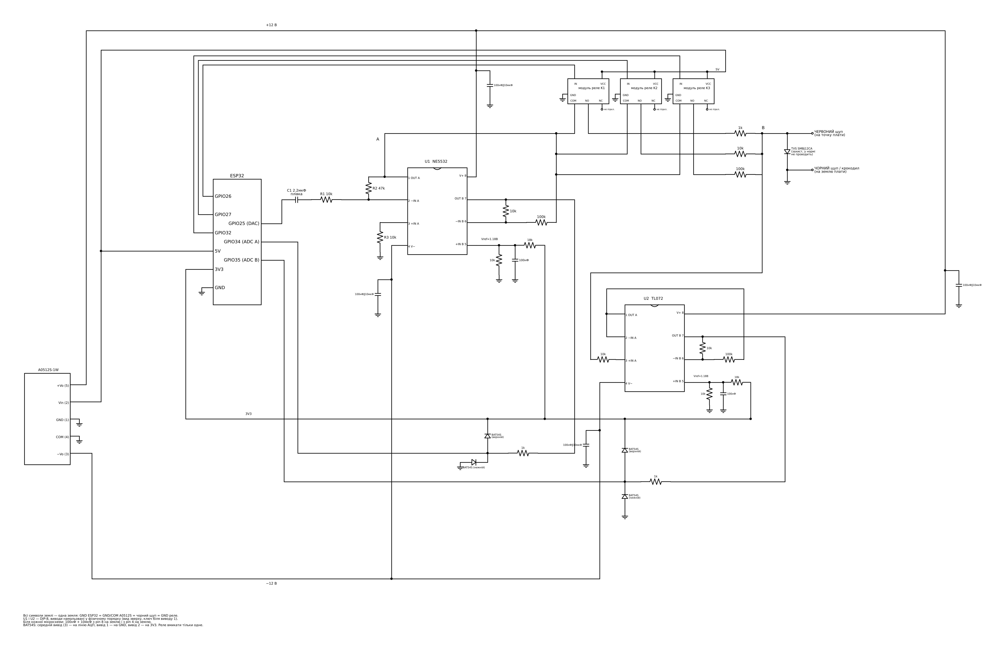

**Українська** | [English](README.en.md)

# V-I Tester

Відкритий DIY V-I тестер (аналізатор аналогових сигнатур, як Huntron Tracker) на ESP32 для діагностики плат без подачі живлення.

Прилад подає на точку плати синус через послідовний резистор і знімає залежність струму від напруги. Резистор, діод, конденсатор, КЗ чи обрив дають кожен свою криву. Знімаєш еталон з живої плати, проходиш ті самі точки на дохлій, а програма показує, де криві розходяться.

> **Статус:** прототип, збирання першої версії аналогової частини.

## Як це працює

1. ESP32 генерує синус на DAC (GPIO25, вбудований косинус-генератор, від ~130 Гц).
2. Підсилювач U1A (NE5532) знімає постійну складову (C1) і підсилює сигнал до ±9…10 В (вузол **A**).
3. Одне з трьох реле підключає послідовний резистор Rs: 1k, 10k або 100k (вибір діапазону).
4. Після Rs (вузол **B**) іде червоний щуп. Чорний щуп — це земля приладу, він чіпляється на землю плати.
5. Вимірюються дві напруги:
   - **A** (що подали) через скейлер U1B → GPIO34;
   - **B** (що лишилось на точці) через буфер U2A і скейлер U2B → GPIO35.
6. Струм через точку: `I = (VA − VB) / Rs`. Крива: X = VB, Y = I.

Скейлери переводять ±10.5 В у 0.25…2.35 В для АЦП: `Vadc = 1.30 − 0.1·V` (сигнал інвертований, це враховується в прошивці).

## Схема

 
Векторна версія: [`schematic.svg`](schematic.svg)

Як читати схему: крапка — це з'єднання; лінії, що перетинаються без крапки, не з'єднані. Усі символи землі — одна земля: GND ESP32 = GND/COM A0512S = GND реле = чорний щуп.

### Підключення ESP32

| Пін ESP32 | Куди |
|---|---|
| GPIO25 (DAC1) | вихід синуса → C1 |
| GPIO34 (ADC1) | вимірювання вузла A (через 1k + BAT54S) |
| GPIO35 (ADC1) | вимірювання вузла B (через 1k + BAT54S) |
| GPIO26 | IN реле K1 (Rs = 1k) |
| GPIO27 | IN реле K2 (Rs = 10k) |
| GPIO32 | IN реле K3 (Rs = 100k) |
| 5V | VCC реле, Vin A0512S |
| 3V3 | Vref-подільники, BAT54S (вивід 2) |
| GND | загальна земля |

### Модуль реле

| Вивід | Куди |
|---|---|
| VCC | 5V |
| GND | GND |
| IN | свій GPIO |
| COM | вузол A |
| NO | свій резистор Rs → вузол B |
| NC | не підключено |

Вмикається тільки одне реле одночасно.

## Список компонентів

У дужках вказано, на що замінити, якщо щось не працює як треба (див. розділ [Відомі проблеми](#відомі-проблеми)).

### Активні компоненти і модулі

| Позначення | Компонент | К-сть | Примітка |
|---|---|---|---|
| — | ESP32 DevKit (класичний ESP32 з DAC) | 1 | ESP32-C6/S3 не підходять, у них немає DAC |
| U1 | NE5532P, DIP-8 | 1 | драйвер (A) + скейлер A (B) |
| U2 | TL072CP, DIP-8 | 1 | буфер (A) + скейлер B (B) |
| PS1 | DC-DC A0512S-1W, 5 → ±12 В, ізольований | 1 | |
| K1–K3 | модуль реле 5 В, 1 канал | 3 | (якщо не відпускає від 3.3 В: транзистор між GPIO і IN, або перемичка H/L на модулі в режим high-level) |

### Резистори (металоплівкові, 0.25 Вт)

| Позначення | Номінал | К-сть | Примітка |
|---|---|---|---|
| R1 | 10k | 1 | вхід драйвера |
| R2 | 62k | 1 | підсилення драйвера (**→ 51k**, якщо синус зрізається на вершинах) |
| R3 | 10k | 1 | (+) драйвера на землю |
| Rs1 / Rs2 / Rs3 | 1k / 10k / 100k | 1 / 1 / 1 | діапазони; поміряти мультиметром і вписати реальні значення в прошивку |
| — | 100k | 2 | вхід скейлерів A і B |
| — | 10k | 2 | зворотний зв'язок скейлерів |
| — | 10k | 1 | послідовний на вхід буфера U2A |
| — | 18k | 2 | верх подільників Vref |
| — | 10k | 2 | низ подільників Vref |
| — | 1k | 2 | послідовні на входи АЦП |

**Разом:** 1k ×3, 10k ×8, 18k ×2, 62k ×1, 100k ×3.

### Конденсатори

| Позначення | Номінал | К-сть | Примітка |
|---|---|---|---|
| C1 | 2.2 мкФ плівковий, 63–100 В | 1 | тільки неполярний |
| — | 100 нФ кераміка | 2 | фільтр Vref |
| — | 100 нФ кераміка | 4 | розв'язка ОП: по одному на +12 і −12 біля кожної мікросхеми |
| — | 10 мкФ електроліт, 25 В+ | 4 | розв'язка ОП, паралельно з 100 нФ |
| — | 10 мкФ електроліт, 25 В+ | 3 | біля A0512S: вхід 5 В, вихід +12, вихід −12 |
| — | 100–220 мкФ електроліт, 10 В+ | 1 | на лінію 5V біля реле і A0512S |

### Захист

| Позначення | Компонент | К-сть | Примітка |
|---|---|---|---|
| D1, D2 | BAT54S | 2 | клампи АЦП: вивід 3 на лінію, 1 на GND, 2 на 3V3 |
| TVS1 | SMBJ12CA / 1.5SMBJ12CA | 1 | між вузлом B і GND (**→ 2× 1N4148** від B на ±12 В, а TVS перенести між шинами ±12 В і GND, якщо на діапазоні 100k відкриті щупи дають еліпс) |

### Механіка

| Що | К-сть |
|---|---|
| Панелька DIP-8 | 2 |
| Перфборд | 1 |
| Гнізда під банан 4 мм | 2 |
| Щуп червоний (голка під SMD) | 1 |
| Щуп чорний / крокодил на землю | 1 |
| USB-кабель | 1 |

## Характеристики

| Діапазон | Rs | Струм КЗ щупів (±8.4 / ±10.2 В) | Для чого |
|---|---|---|---|
| Low | 1k | 8.4 / 10.2 мА | КЗ, низькоомні ланцюги |
| Mid | 10k | 0.84 / 1.02 мА | більшість точок |
| High | 100k | 84 / 102 мкА | входи мікросхем, витоки |

- Амплітуда на щупі (щупи в повітрі): ~±9…10 В. Програмно ділиться на 2, 4 або 8 (±4.6 / ±2.3 / ±1.2 В).
- Для плат з лініями 1.8 / 1.2 В (Apple і т. ін.) краще працювати на ±2.3 або ±1.2 В.
- Більше ~10 мА прилад видати не може фізично (обмежує Rs).

## Живлення

Усе живиться від одного USB-кабелю, по ньому ж ідуть дані. Пін 5V на ESP32 DevKit — це майже напряму VBUS з USB.

Приблизне споживання: ESP32 50–80 мА (з WiFi до ~250 мА), A0512S ~120 мА, одне реле ~75 мА. Разом 250–300 мА, тобто в межах USB 2.0 (500 мА). WiFi під час вимірювань краще вимкнути.

Перевір напругу на піні 5V під навантаженням: на деяких платах там стоїть діод, і виходить 4.3–4.7 В. A0512S потребує мінімум 4.5 В.

## Безпека

- **Плата, яку тестуєш, має бути знеструмлена:** без зарядки, без батареї, з розрядженими конденсаторами.
- Не подавай зовнішню напругу на щупи.
- Після переключення реле почекай 20–50 мс (брязкіт контактів), і тільки потім вимірюй.

## Відомі проблеми

### Синус зрізається на вершинах
Косинус-генератор ESP32 може видати до 3.3 В пік-пік, після ×6.2 це ±10.2 В. NE5532 на ±12 В гарантує тільки ~±9 В.
**Фікс:** R2 62k → 51k (амплітуда ~±8.4 В), або поміряти сигнал на GPIO25 і підібрати R2.

### На діапазоні 100k відкриті щупи дають еліпс замість горизонтальної лінії
Ємність TVS (SMBJ12CA ~1.2 нФ, у 1.5SMBJ ще більше) стоїть паралельно щупам. На 150 Гц це ~11–28% похибки на 100k і ~1–3% на 10k. Програмно не компенсується, бо ємність нелінійна.
**Фікс:** прибрати TVS з вузла B і поставити:
- 1N4148: анод на B, катод на +12 В;
- 1N4148: анод на −12 В, катод на B;
- SMBJ12CA між +12 В і GND (другу між −12 В і GND).

### Реле не вимикається
Більшість модулів спрацьовують від низького рівня, а 3.3 В з ESP32 не завжди вистачає, щоб модуль на 5 В вимкнувся.
**Фікс:** транзистор між GPIO і IN або перемичка H/L на модулі.

## Плани

- [ ] Зібрати аналогову частину, зняти перші криві (резистор / діод / конденсатор)
- [ ] Прошивка: генерація, вибір діапазону, стрім семплів по USB
- [ ] Python-скрипт для перегляду кривих у реальному часі
- [ ] Режим порівняння: еталон → дохла плата, метрика розбіжності
- [ ] Автоматичне захоплення точки при контакті щупа
- [ ] Форк OpenBoardView: завантаження boardview, план скану по лініях, підсвітка точок
- [ ] База еталонних сигнатур за номером плати
- [ ] Android-клієнт

## Посилання

- [Huntron Tracker](https://rbdinstruments.com/blog/tag/huntron-tracker) — оригінальна ідея (1979)
- [ESP-IDF DAC](https://docs.espressif.com/projects/esp-idf/en/v4.4.1/esp32/api-reference/peripherals/dac.html) — косинус-генератор
- [NE5532 datasheet](https://www.ti.com/lit/gpn/ne5532)
- [OpenBoardView](https://github.com/OpenBoardView/OpenBoardView)
